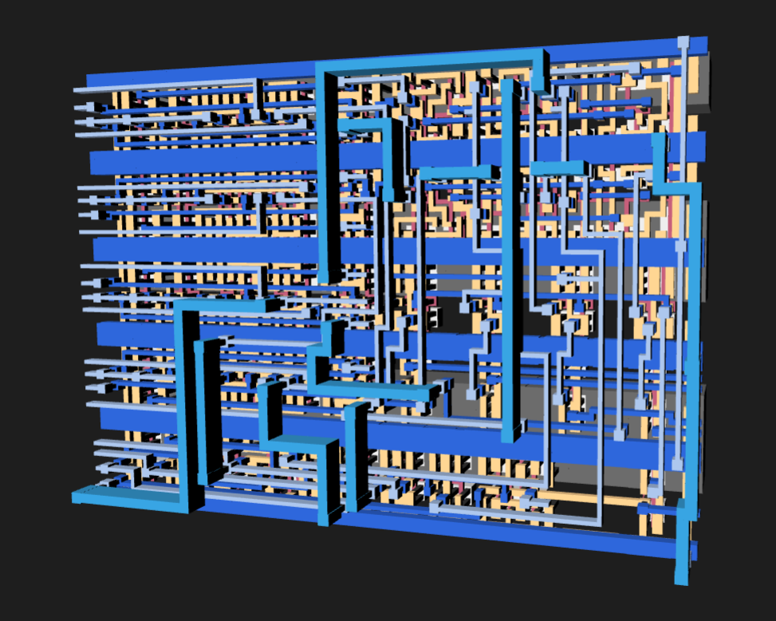
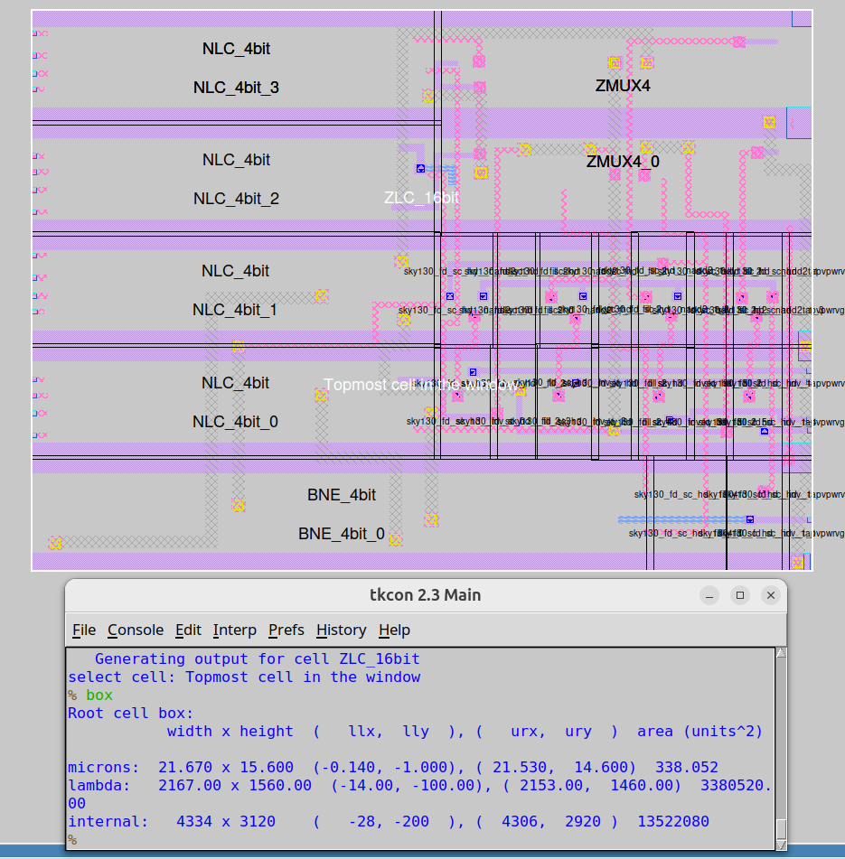
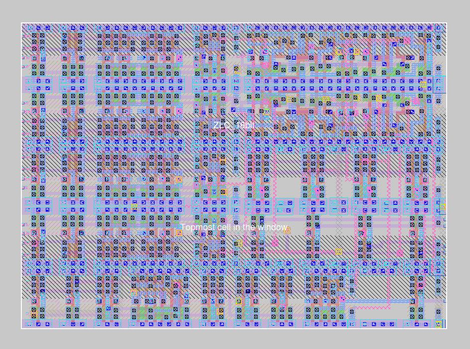
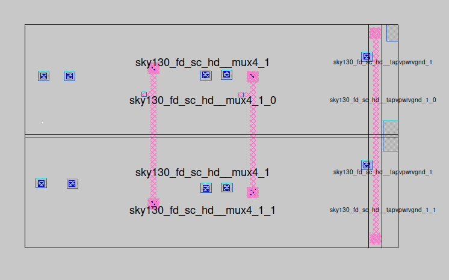
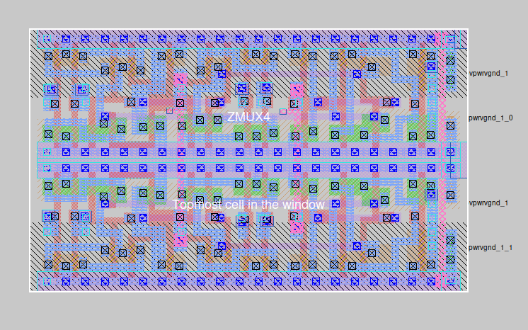

# ZLC16 — 16-bit Leading-Zero Counter on SkyWater SKY130

Full-custom layout of a 16-bit leading-zero counter (ZLC), taken from schematic to LVS-clean layout on the open-source **SkyWater 130 nm** PDK, with post-layout critical-path simulation and static timing analysis.



## Overview

| | |
|---|---|
| **Function** | Counts consecutive `0` bits from the MSB of `A[15:0]` until the first `1` |
| **Interface** | `A[15:0]` → `Y[4:0]` |
| **Type** | Purely combinational (no flip-flops) |
| **Technology** | SKY130, `sky130_fd_sc_hd` standard cells |
| **Tools** | Xschem · Magic · Netgen (LVS) · ngspice · OpenSTA |

Example: `A = 0001_0110_0010_0000` → 3 leading zeros → `Y = 00011`.

### Hierarchy

| Block | Description |
|---|---|
| `NLC_4bit` (×4) | Leading-zero count of one 4-bit nibble |
| `BNE_4bit` | Nibble-level encoder: finds the first non-zero nibble (upper bits of `Y`) |
| `ZMUX4` | 4:1 mux selecting that nibble's count (lower bits of `Y`) |
| `ZLC_16bit` | Top level |

## Results

STA with OpenSTA at the `tt_025C_1v80` corner (TT, 25 °C, 1.8 V), constrained at 100 MHz:

| Metric | Value |
|---|---|
| Max frequency | ≈ 690 MHz (1.45 ns worst path) |
| Setup slack @ 100 MHz | 8.55 ns |
| Hold slack | 0.14 ns |
| Total power @ 100 MHz | 3.63 µW (57.9 % internal, 42.1 % switching) |
| Leakage power | 0.113 nW |

**Critical path:** `A7 → Y1`, 1.25 ns propagation. The `sky130_fd_sc_hd__mux4_1` cell accounts for 0.56 ns (≈ 45 %). Splitting it into two `mux2` stages is the main optimization lever.

**LVS:** all four cells (`NLC_4bit`, `BNE_4bit`, `ZMUX4`, `ZLC_16bit`) report *Netlists match uniquely* — see [`lvs/reports/`](lvs/reports).

## Repository structure

```
├── xschem/          # Schematics (.sch) and symbols (.sym)
├── magic/           # Layouts (.mag), extraction (.ext, .spice, .rcx.raw), final GDS
├── lvs/
│   ├── run_lvs.sh   # Netgen LVS script: ./run_lvs.sh <cell>
│   └── reports/     # LVS logs per cell
├── sim/             # ngspice testbench for critical-path measurement (A7 → Y1)
└── images/          # Layout screenshots
```

## Layout gallery

| Top cell | Expanded layout |
|---|---|
|  |  |
|  |  |

## Reproduce LVS

```bash
export PDK_ROOT=/path/to/pdk PDK=sky130B
cd lvs
./run_lvs.sh ZLC_16bit      # compares ../xschem/ZLC_16bit.spice vs ../magic/ZLC_16bit.spice
```

> The script expects the Xschem netlist exported to `xschem/<cell>.spice`.
